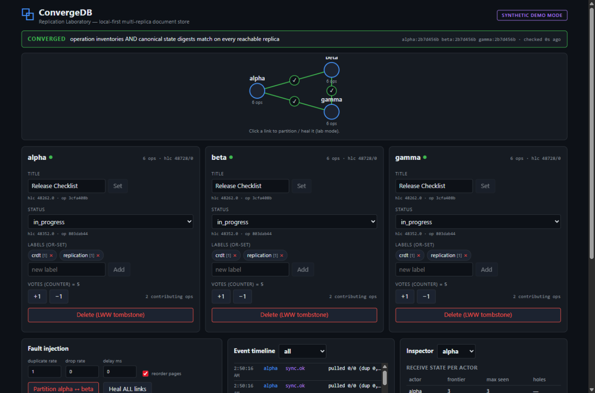
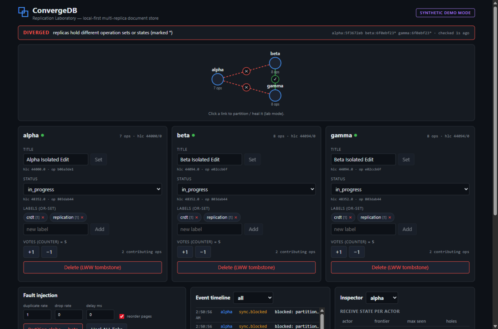

# ConvergeDB

**A local-first, multi-replica document database with offline edits, durable operation logs, hole-aware anti-entropy replication — and a visual laboratory that proves how it behaves.**

ConvergeDB is a small, coherent open-source project for learning and demonstrating *real* replication semantics: three independent replicas, each with its own SQLite database, keep accepting writes while disconnected; when the network returns, only missing operations are exchanged, conflicts resolve deterministically, and every replica verifies — with digests, not optimism — that it holds the same operation inventory and the same canonical state as its peers.





*(Both screenshots were captured from the running application against three live replicas — the second one mid-partition, with the convergence checker truthfully reporting `DIVERGED`.)*

---

## What actually works (all of it tested)

| Capability | How it is tested |
|---|---|
| Hybrid logical clock: `(wall, counter, actor)` total order, wall-clock rollback safety, persisted watermark | unit tests (`internal/clock`) |
| Typed operations with content-addressed IDs + SHA-256 integrity checksums; op ID reuse with a different body is a protocol conflict, never an overwrite | unit + API tests |
| **LWW register** (deterministic tie-break), **OR-Set** (observed-remove with tombstones, add-wins), **delta counter** (idempotent, overflow-safe) | exhaustive permutation tests over all 7! orderings of a mixed history; duplicate-laden randomized schedules |
| Durable log: WAL + `synchronous=FULL`, ACK strictly after commit, dense actor sequences allocated in the commit transaction, corruption fails closed | restart/kill tests, corruption test, concurrent-append test |
| Replication: bidirectional pull with **per-actor frontier + hole tracking** (a gap `1,2,5` is never "done at 5"), cursor pagination, idempotent ingest | store tests + two-node tests over real HTTP, duplicate/reorder fault storms |
| Fault injection (lab mode): partition, drop, duplicate, delay, reorder — seeded and reproducible | three-replica scenarios; 8/8 green under `-race` |
| Convergence verification: `CONVERGED` requires **operation-inventory equality AND canonical state equality** on every reachable replica; unreachable peers mean `UNKNOWN`, never convergence | `convergedb demo partition-heal` end-to-end |
| Seeded one-command demo: 3 real OS processes, partition → isolated writes → duplicate+reorder → kill/restart a replica → heal → verified convergence → JSON report | `convergedb demo partition-heal` (exit code nonzero on any failed invariant) |
| Web laboratory: live topology, per-replica editors, real SSE event timeline, operation inspector with receive-gaps, convergence banner with staleness indicator | verified in a real browser against live replicas |

## Quickstart (60 seconds)

Requirements: [Go 1.22+](https://go.dev/dl/) and Node.js + npm (only for the UI build).

```bash
git clone https://github.com/PrathamKapoor/ConvergeDB
cd ConvergeDB

# 1. build the binary and the web workbench
go build -o convergedb ./cmd/convergedb
(cd web && npm install && npm run build)

# 2. run the seeded three-replica partition-heal demo
./convergedb demo partition-heal --seed 42
# → starts 3 REAL processes with their own SQLite files
# → partitions alpha from beta/gamma, writes on both sides
# → duplicates + reorders exchanges, kills and restarts beta
# → heals, verifies convergence, writes var/reports/partition-heal-report.json
# → exits nonzero if any invariant fails
```

## Run the interactive laboratory

```bash
# three replicas; alpha serves the built web UI
./convergedb serve --id alpha --db ./var/alpha.db --http 127.0.0.1:8101 --lab \
  --web ./web/dist --peers "beta=http://127.0.0.1:8102,gamma=http://127.0.0.1:8103" &
./convergedb serve --id beta  --db ./var/beta.db  --http 127.0.0.1:8102 --lab \
  --peers "alpha=http://127.0.0.1:8101,gamma=http://127.0.0.1:8103" &
./convergedb serve --id gamma --db ./var/gamma.db --http 127.0.0.1:8103 --lab \
  --peers "alpha=http://127.0.0.1:8101,beta=http://127.0.0.1:8102" &
```

Open **http://127.0.0.1:8101/** — edit the title/labels/votes on any replica, watch them replicate; click a link in the topology to partition it; watch the banner flip to `DIVERGED` while isolated and back to `CONVERGED` after healing.

Or with Docker (builds the binary and UI, starts the 3-node lab):

```bash
docker compose up --build
# → http://localhost:8101/
```

## Tests

```bash
go test ./...            # 48 tests: units, store, HTTP replication, hardening
go test -race ./...      # concurrency-clean
go test ./tests/model    # exhaustive permutation + randomized exchange model checks
```

## The data model (deliberately narrow)

A **document** is a schema-validated set of typed fields (used by the bundled project-board example):

| field | type | merge semantics |
|---|---|---|
| `title` | text (≤512 runes) | LWW register — latest HLC wins, deterministic `(wall, counter, actor)` tie-break |
| `status` | enum: `backlog` `in_progress` `review` `done` | LWW register |
| `labels` | set of strings (1..64 runes each) | OR-Set — removes kill only the add-tags they observed; concurrent adds survive |
| `votes` | integer counter | operation-delta counter — replaying an op never double-counts; concurrent deltas both survive |
| deleted | tombstone flag | LWW register (`doc.delete` / `doc.restore`) |

Everything travels as **operations** (`doc.create`, `field.set`, `label.add`, `label.remove`, `vote.delta`, `doc.delete`, `doc.restore`) with a canonical JSON encoding, a content-derived op ID, and a SHA-256 checksum. See [docs/PROTOCOL.md](docs/PROTOCOL.md) and [docs/CONSISTENCY.md](docs/CONSISTENCY.md).

## Honest limitations (read before deploying anything)

- **Trusted-local scope.** Nodes bind to loopback by default; non-loopback binds refuse to start without `--token`. There is no TLS, no peer identity verification beyond a shared bearer, and no defense against a malicious LAN peer. This is a laboratory, not a hardened server.
- **Faults simulate the network, not the nodes.** The lab's partition/drop/duplicate/reorder shim gates each replica's sync exchanges (real HTTP between real processes). A real firewall cannot recall in-flight packets; the shim here discards them for deterministic lab semantics.
- **No tombstone GC.** Removed OR-Set tags and the full operation log are kept forever (no verified causal-stability predicate exists to make deletion safe). Disk usage grows with history.
- **LWW can discard intent.** Concurrent title edits resolve to ONE winner; the loser's text is not merged anywhere.
- **Power-loss durability is not tested.** Process-kill durability is. `synchronous=FULL` is the right setting, but only your OS/hardware can make real fsync promises.
- **Benchmarks are single-machine.** See [docs/RESULTS.md](docs/RESULTS.md) for measured numbers and an explicit `NOT MEASURED` list.

More: [docs/ARCHITECTURE.md](docs/ARCHITECTURE.md) · [docs/SECURITY.md](docs/SECURITY.md) · [docs/TEST_MATRIX.md](docs/TEST_MATRIX.md) · [docs/DEMO.md](docs/DEMO.md) · [docs/COMPARISON.md](docs/COMPARISON.md) · [docs/REPRODUCIBILITY.md](docs/REPRODUCIBILITY.md)

## License

MIT — see [LICENSE](LICENSE).
